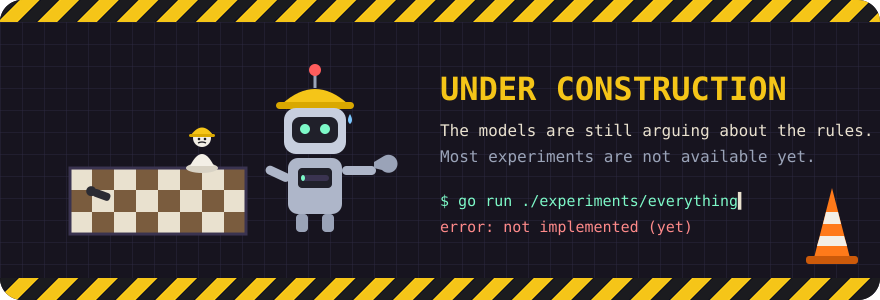
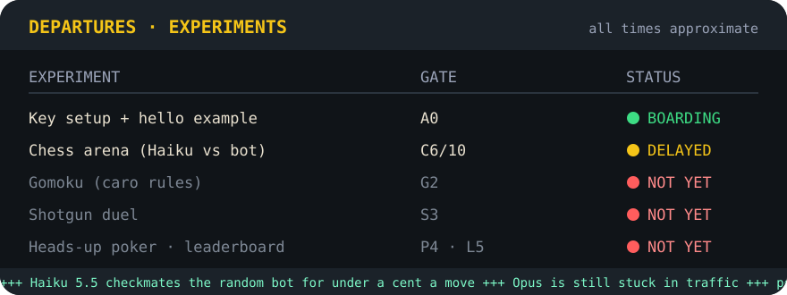

# claude-api-credits-playground

<p align="center"></p>

> **Work in progress.** The key setup guide and the hello example work today. The experiments are still being built, and most are not available yet.

How to set up a Claude API key that bills the credit your plan includes, and then spend that credit on silly, measurable experiments: models playing chess against each other, bluffing at poker, and so on.

Everything here uses the **official route**: an API key created in the Claude Console, in an organization whose API credit comes with your plan. Nothing here extracts or reuses a Claude.ai or Claude Code login token. That breaks Anthropic's terms, and this repo won't help with it.

## Contents

| Path | What it is |
|---|---|
| [`docs/local-setup.md`](docs/local-setup.md) | Step by step: install, create the key, store it, make the first paid call, troubleshoot |
| [`docs/setup-keys.md`](docs/setup-keys.md) | Create the key, cap its spend, keep it out of your shell history and logs |
| [`docs/discoveries.md`](docs/discoveries.md) | API behaviour, pricing and SDK gotchas learned the hard way, with measured numbers |
| [`PLAN.md`](PLAN.md) | The experiments, in order, each with a budget and a gate |
| [`examples/hello-credits`](examples/hello-credits) | One Messages API call in Go that reads its key from a dedicated variable and prints what the call cost |

## Quick start

```bash
# 1. Put the key in a private file (full steps: docs/local-setup.md)
mkdir -p ~/.config/arena && install -m 600 /dev/null ~/.config/arena/key
$EDITOR ~/.config/arena/key

# 2. Run the hello example
cd examples/hello-credits
ARENA_ANTHROPIC_API_KEY="$(cat ~/.config/arena/key)" go run . "Say hi in five words."
```

The example prints the reply, the token counts, and the estimated USD cost, using the prices in `prices.yaml`.

## Experiments

<p align="center"></p>

1. **Chess arena:** done. Phase 0 runs in [vibecheck-chess](https://github.com/tyler-void/vibecheck-chess) (`cmd/arena`). Haiku 5.5 beats a random-legal bot for under a cent per move; numbers are in `docs/discoveries.md`.
2. Gomoku, a shotgun duel and heads-up poker: planned, see `PLAN.md`.

## License

MIT
